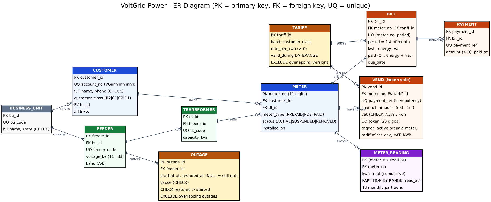

# Portfolio 1 — Database Design: ERD, Schema, Normalisation and Constraints

## Case study: VoltGrid Power

VoltGrid Power is a simulated electricity distribution company serving Lagos, Ogun and Oyo through **8 business units** (Ikeja, Ikorodu, Ota, Abeokuta, Ibadan North, Ibadan South, Ogbomoso, Oyo Town). Power reaches customers through feeders and distribution transformers. Following the regulator's *service-based tariff*, every feeder has a **band (A–E)** that sets both the promised hours of supply and the price per kWh.
- **Prepaid customers** buy tokens through the app, banks, POS, USSD and agents.
- **Postpaid (maximum-demand) customers** are read daily and billed monthly.
- **Outages** are logged per feeder.

The database must prevent the mistakes that cost money or trust:
- a payment notification turned into **two tokens**;
- a token sold to a **suspended** or **postpaid** meter;
- a sale priced with the **wrong tariff**;
- two tariff versions valid on the same day;
- a bill **overpaid**, or billed twice for one month;
- a feeder with two overlapping outages.

The same database is used in all five portfolios.

## 1. ERD



Source: [`erd.dot`](erd.dot) (Graphviz; also [`erd.svg`](erd.svg)). 11 tables in schema `voltgrid` (`meter_reading` has 13 monthly partitions), plus the view `v_meter`.

| Group | Tables | Notes |
|---|---|---|
| Network | `business_unit` → `feeder` → `transformer` | feeder band A–E, 11 or 33 kV |
| Pricing | `tariff` | one row per *version*: band × customer class × `valid_during DATERANGE` |
| Customers | `customer` → `meter` | account `VGnnnnnnnnnn`; class R2/C1/C2/D1; a meter is PREPAID or POSTPAID and ACTIVE/SUSPENDED/REMOVED |
| Prepaid | `vend` | one token sale; `payment_ref` UNIQUE; VAT, kWh and tariff are set by a trigger |
| Postpaid | `meter_reading` (partitioned), `bill` → `payment` | cumulative daily readings; one bill per meter per month |
| Operations | `outage` | per feeder; `restored_at` NULL while the feeder is still out |

## 2. Data volume ([`02_seed_data.sql`](02_seed_data.sql) → [`evidence/table_row_counts.txt`](evidence/table_row_counts.txt))

Exact counts after seeding (1 Nov 2025 – 12 Nov 2026; Yoruba-dominant names, Nigerian phone formats; reproducible with `setseed`). The database is 554 MB.

| Table | Rows | | Table | Rows |
|---|---:|---|---|---:|
| meter_reading (13 partitions) | 2,644,634 | | meter | 42,000 |
| vend | 823,792 | | customer | 40,000 |
| bill | 85,032 | | outage | 39,763 |
| payment | 76,272 | | transformer / feeder | 1,200 / 120 |
| tariff | 40 | | business_unit | 8 |

All 823,792 sales were inserted **through the pricing trigger**, so every sale was priced by the database itself. The seed reflects the band structure: 1,000 naira buys **4.3 kWh on band A but 28.3 kWh on band E**, and the average outage lasts 2.5 h on band A and 17.6 h on band E ([`evidence/seed_rule_verification.txt`](evidence/seed_rule_verification.txt)).

## 3. Normalisation

| Form | How the schema meets it |
|---|---|
| **1NF** | atomic values: each reading, sale, payment and outage is its own row; no lists of meters or readings in a column |
| **2NF** | the composite keys `meter_reading (meter_no, read_at)` and `bill UNIQUE (meter_no, period)` have non-key columns that depend on the whole key (the reading on that day, the bill for that month) |
| **3NF / BCNF** | the band belongs to the **feeder**, and the business unit is stored once on the feeder and once on the customer, so the band is never copied into `meter` or `customer`; the rate per kWh lives only in `tariff`; every determinant is a candidate key |
| **Derived values** | consumption is `max − min` of the cumulative register, not stored; `v_meter` joins meter → customer → transformer → feeder → business unit |

**Deliberate decisions**
- **`vend.kwh`, `vend.vat` and `vend.tariff_id` are stored**, although they could be recomputed. They are *historical facts*: a token sold in June at ₦209.50/kWh must still show 209.50 after the July tariff review. Storing them is not redundancy, and the trigger guarantees that they are correct when written.
- **Tariffs are versioned by date range** rather than updated in place, so old sales and bills stay explainable. An exclusion constraint keeps the versions from overlapping.
- **`meter_reading` is partitioned by month** because it is the largest and fastest-growing table. Queries for one month touch one partition (Portfolio 2), and old months can be detached for archiving (Portfolio 3).

## 4. Constraints ([`01_schema.sql`](01_schema.sql), tested in [`03_constraint_tests.sql`](03_constraint_tests.sql) → [`evidence/constraint_tests_output.txt`](evidence/constraint_tests_output.txt))

| # | Rule | Mechanism | Result |
|---|---|---|---|
| T1 | two tariff versions of one band/class never overlap | `EXCLUDE USING gist (band WITH =, customer_class WITH =, valid_during WITH &&)` | rejected |
| T2 | no token for a SUSPENDED meter | `BEFORE INSERT` trigger `vend_price()` | rejected: *meter 45100008245 is SUSPENDED: vending blocked* |
| T3 | no token for a POSTPAID meter | trigger | rejected |
| T4 | one payment → at most one token (idempotency) | `UNIQUE (payment_ref)` | rejected (23505) |
| T5 | minimum sale ₦500 | `CHECK (amount BETWEEN 500 AND 1000000)` | rejected |
| T6 | readings only for known months | partitioned table **without a DEFAULT partition** | rejected: *no partition of relation "meter_reading" found for row* |
| T7 | one bill per meter per month | `UNIQUE (meter_no, period)` | rejected |
| T8 | bill period is the 1st of a month | `CHECK (period = date_trunc('month', period))` | rejected |
| T9 | a bill cannot be overpaid | `CHECK (paid >= 0 AND paid <= energy + vat)` | rejected |
| T10 | no overlapping outages on one feeder | `EXCLUDE USING gist (feeder_id WITH =, tstzrange(started_at, restored_at) WITH &&)` | rejected |
| T11 | restored after started | `CHECK (restored_at > started_at)` | rejected |
| T12 | a customer with meters cannot be deleted | FK with default `RESTRICT` | rejected |
| T13 | account number format | `CHECK (account_no ~ '^VG[0-9]{10}$')` | rejected |
| Control | ₦10,000 sale to an active prepaid band B / R2 meter | trigger computes VAT **₦697.67**, tariff 16 (₦66.47/kWh, version from 1 Jul 2026), **139.95 kWh**, 20-digit token | **accepted**, then rolled back |

**Why a trigger for pricing (T2, T3, control):** the price depends on *other tables*: the meter's type and status, its feeder's band, the customer's class and the tariff version valid on the day of sale. A CHECK constraint sees only the row itself. Computing VAT and kWh in the database means a client can never send a wrong figure. The `CHECK (vat = round(amount × 0.075 / 1.075, 2))` remains as a second, independent guard.

**The seed obeys the rules** ([`04_verify_seed_rules.sql`](04_verify_seed_rules.sql) → [`evidence/seed_rule_verification.txt`](evidence/seed_rule_verification.txt)): **0 violations** for all 7 checks:
- sales only to prepaid meters;
- the correct tariff version on the day of sale;
- kWh = (amount − VAT) / rate;
- each meter on a transformer in its customer's business unit;
- no cumulative register ever going backwards (2.64 million readings);
- `bill.paid` equal to the sum of its payments;
- no overlapping outages.

## How to run

```bash
createdb voltgrid
psql -d voltgrid -f 01_schema.sql
psql -d voltgrid -f 02_seed_data.sql                     # about 2 minutes (sales go through the pricing trigger)
psql -d voltgrid -f 03_constraint_tests.sql > evidence/constraint_tests_output.txt 2>&1
psql -d voltgrid -f 04_verify_seed_rules.sql > evidence/seed_rule_verification.txt
dot -Tpng erd.dot -o erd.png
```
