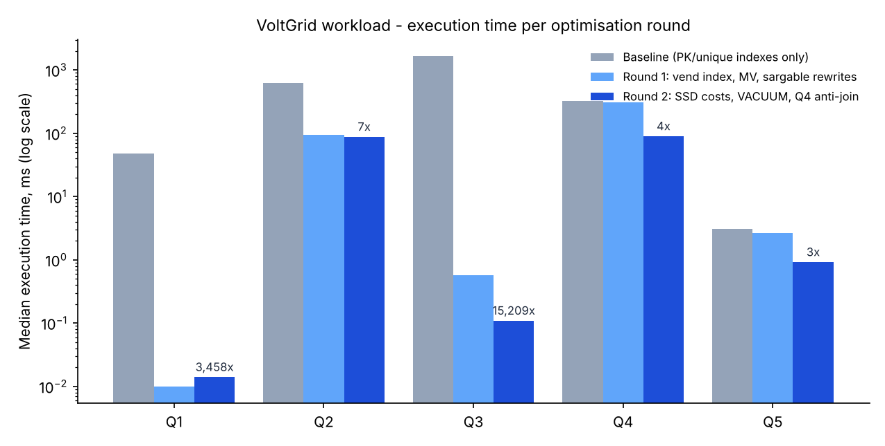

# Portfolio 2 — Query Processing and Optimisation

Case study: **VoltGrid Power**. Five queries from the real workload were measured on the Portfolio 1 data set: 823,792 token sales, 2.64 million meter readings in 13 monthly partitions, and 39,763 outages. Each query was measured with `EXPLAIN (ANALYZE, BUFFERS)` in three phases, and the plan of each phase was saved.

| File | Purpose |
|---|---|
| [`queries.sql`](queries.sql) | the 5 workload queries as first written |
| [`optimisations_round1.sql`](optimisations_round1.sql) | index on sales per meter, dashboard materialised view; Q2 and Q5 rewritten |
| [`optimisations_round2.sql`](optimisations_round2.sql) | SSD cost settings; Q4 rewritten as an index anti-join (decided after reading the round-1 plans) |
| [`run_benchmark.py`](run_benchmark.py) | harness: 1 warm-up + 7 measured runs per query and phase, median reported; checks that every rewritten query returns **exactly the same rows** |
| [`plans/`](plans/) | 15 plans (`Q1_baseline.txt` … `Q5_round2.txt`) |
| [`evidence/`](evidence/) | `benchmark_results.csv`, `benchmark_chart.png`, `result_equivalence.txt`, `mv_refresh_and_sizes.txt` |

## Results (median of 7 warm runs, ms)

| Query | Baseline | Round 1 | Round 2 | Speed-up | Buffers (base → final) |
|---|---:|---:|---:|---:|---|
| Q1 app: my last 10 purchases | 48.4 | 0.010 | 0.014 | ~3,460× | 13,581 → 9 |
| Q2 October energy per business unit and band | 624.5 | 93.7 | 87.6 | 7× | 36,303 → 2,379 |
| Q3 revenue dashboard 2026 | 1,657.8 | 0.57 | 0.11 | ~15,000× | 14,984 → 349 |
| Q4 meters with no purchase in 90 days | 324.8 | 304.8 | 89.6 | 3.6× | 14,993 → 106,985 |
| Q5 supply hours of band A feeders | 3.09 | 2.67 | 0.92 | 3.4× | 325 → 474 |



All rewritten queries returned identical rows ([`evidence/result_equivalence.txt`](evidence/result_equivalence.txt)).

## What each plan showed

**Q1 — a missing index on a foreign key.** `vend` only had indexes on its primary key, `payment_ref` and `token`. "Purchases of meter X" therefore became a **Parallel Seq Scan of all 823,792 rows** (13,581 buffers) to return 6 rows. The composite index `(meter_no, vended_at DESC)` matches both the filter and the sort order. The plan became an `Index Scan` that stops after `LIMIT 10`, reading 9 buffers. PostgreSQL does **not** index foreign-key columns automatically.

**Q2 — partition pruning needs a sargable predicate.** `meter_reading` is partitioned by month, yet the first version read **all 13 partitions** (13 `Seq Scan on meter_reading_…` nodes, 36,303 buffers). The filter `date_trunc('month', read_at AT TIME ZONE 'Africa/Lagos') = '2026-10-01'` hides `read_at` inside functions, so the planner cannot match it to the partition bounds. Rewritten as `read_at >= '2026-10-01 00:00+01' AND read_at < '2026-11-01 00:00+01'`, the same query touches **only `meter_reading_2026_10`** (7× faster) and returns the same 40 rows. No index was needed. Round 2 gained nothing more: the query needs every October reading of every postpaid meter (≈217,000 rows) to compute `max − min`. The next step would be storing a monthly total when bills are produced.

**Q3 — summaries instead of raw rows.** The dashboard grouped ~690,000 sales of 2026 through four joins (1.66 s). The materialised view `mv_monthly_vend_revenue` holds 440 summary rows (112 kB) and returns the same answer in 0.1–0.6 ms. The cost moves to refresh time: a full `REFRESH` took 1.08 s, and `REFRESH … CONCURRENTLY` took 0.87 s while still allowing reads (it needs the unique index). For a dashboard refreshed after each day's settlement, data that is a few hours old is acceptable. For a customer's balance it would not be.

**Q4 — an index does not help if the query shape prevents its use.** Round 1's index did not change the plan at all (304.8 ms). The query computed `max(vended_at)` for **every** meter (a full aggregate of 823,792 rows) and only then filtered. Round 2 rewrote it as an **anti-join**: for each of the 33,850 active prepaid meters, `NOT EXISTS` probes the index for one sale in the last 90 days. Only for the 1,154 meters that have none does it read the latest sale (a LATERAL `max`, which is the first index entry). After `VACUUM`, both probes are `Index Only Scan`s (`Heap Fetches: 0`). Time fell to 89.6 ms with the same 50 rows. Buffers rose from 14,993 to 106,985, because 33,850 small probes touch more pages than one sequential pass, but all of them were in memory. **Fewer buffers is not always faster, and more is not always slower; it depends on whether the pages are cached.**

**Q5 — reuse the index a constraint already built.** The exclusion constraint `outage_no_overlap` already created a GiST index on `(feeder_id, tstzrange(started_at, restored_at))`. The first version compared `started_at` and `restored_at` separately, so it could not use it: `Seq Scan on outage`. Rewritten with the **same expression and the overlap operator** (`tstzrange(started_at, restored_at) && tstzrange(window)`), the plan uses `Index Scan using outage_no_overlap`, once per band A feeder (24 loops). The table is small (40,000 rows), so the gain in milliseconds is small (3.1 → 0.9 ms). The method matters more as the outage history grows. The answer itself was good news for the regulator report: every band A feeder averaged **22.0–23.0 hours** of supply per day, above the 20-hour promise.

## Lessons

- A partitioned table is only as fast as the predicate allows: **wrap the constant, not the column**.
- Index foreign-key columns that are used for lookups. The database does not do it for you.
- A query that aggregates before it filters cannot use a selective index. Rewriting the query (anti-join + LATERAL) helped more than adding objects.
- Constraints are not only rules: an exclusion constraint's GiST index is also an access path.
- Every optimisation has a cost: the vend index takes **32 MB** (the table is 106 MB) and slows every sale slightly; the materialised view must be refreshed; `random_page_cost = 1.1` assumes SSD storage.

## How to run

```bash
pip install psycopg2-binary matplotlib
python3 run_benchmark.py          # resets to baseline, runs the 3 phases (~6 minutes), writes plans/ and evidence/
```
