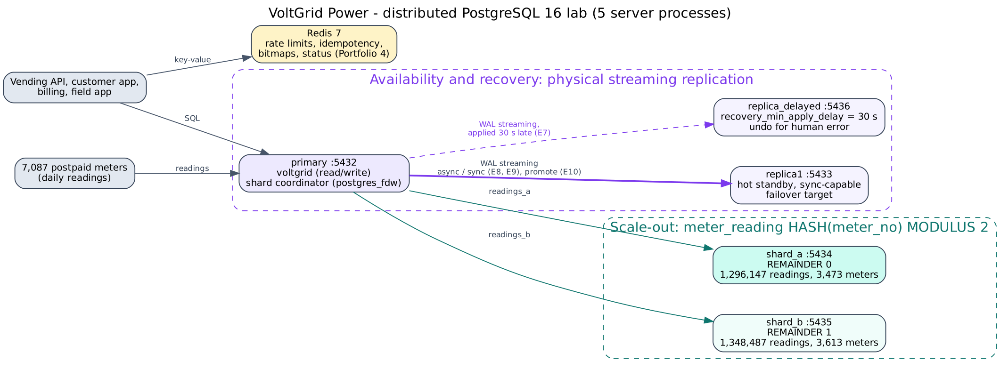

# Portfolio 5 — Distributed and Cloud Database Exercise

Case study: **VoltGrid Power**. Meter readings are the fastest-growing data: 2.64 million daily readings from 7,087 postpaid meters, and many times more once smart meters report every 15 minutes. The company also needs a database that survives a server failure without losing a token sale, and one that can **undo a human mistake** such as a `DELETE` without a `WHERE`. Hash sharding, synchronous and asynchronous replication, failover and a **delayed standby** were built and tested.



## 1. What was built ([`01_setup_cluster.sh`](01_setup_cluster.sh), [`02_sharding.sql`](02_sharding.sql))

| Node | Port | Role |
|---|---|---|
| primary | 5432 | VoltGrid database from Portfolios 1–4; **shard coordinator** (`postgres_fdw`) |
| replica1 | 5433 | physical hot standby (`pg_basebackup -R`, slot `replica1_slot`); synchronous-capable; failover target |
| replica_delayed | 5436 | physical standby with **`recovery_min_apply_delay = '30s'`** (slot `replica_delayed_slot`) |
| shard_a | 5434 | readings of meters with `hash(meter_no)` remainder 0 |
| shard_b | 5435 | readings of meters with `hash(meter_no)` remainder 1 |

- **Shard key = meter number, HASH partitioning** (`PARTITION BY HASH (meter_no)`, `MODULUS 2`), with each partition a foreign table on one shard. Every reading of a meter is on one shard, so a meter's history and its `max − min` consumption never need two servers.
- **`bu_code` and `band` are copied into each shard row.** A foreign table cannot be joined to local tables *on the shard*, so without these columns every area report would have to pull rows back to the coordinator to join them with `meter`. This is deliberate, controlled denormalisation: a meter's business unit and band change rarely, and a move is a re-sharding event.
- Loading 2,644,634 readings through the coordinator (`batch_size '2000'`) took 25.3 s: **1,296,147 to shard_a (3,473 meters) and 1,348,487 to shard_b (3,613 meters)**.

## 2. Experiments ([`03_distributed_tests.py`](03_distributed_tests.py) → [`evidence/03_distributed_tests_output.txt`](evidence/03_distributed_tests_output.txt))

| # | Experiment | Result |
|---|---|---|
| E1 | October consumption of one meter (customer portal) | 193.3 kWh from 31 readings; the plan has one `Foreign Scan on readings_b`; shard_a is not contacted (hash pruning); 0.46 ms |
| E2 | band E readings received on 11 Nov per business unit (no meter in the filter) | `Append` of **two `Async Foreign Scan`s**: both shards are asked in parallel; 155.6 ms |
| E3 | October energy per business unit (`max − min` per meter, then sum; 8 rows) | push-down OFF: every October reading goes to the coordinator, **260 ms**. ON: `Relations: Aggregate on (readings_a)`, the Remote SQL contains `max(kwh_total) - min(kwh_total)` … `GROUP BY meter_no`, **139 ms**. Same answer as the single node, which took **67 ms** |
| E4 | balance | hash: **49.0% / 51.0%**. A split by state (Lagos + Ogun / Oyo) would be 60% / 40% |
| E5 | shard_b stopped | a meter on shard_a still answers (375 readings); a meter on shard_b **and the Ikeja business-unit report** fail with `could not connect to server "srv_shard_b"`; everything works after restart |
| E6 | replication status | both standbys `streaming`; commit → visible on replica1, median **0.90 ms**; a write on the standby is rejected (`read-only transaction`) |
| **E7** | **`DELETE FROM payment` without a WHERE clause** | replica1 had **0 payments 200 ms later**: replication copied the mistake at once. replica_delayed still had **all 76,273**. The DBA paused its replay (`pg_wal_replay_pause()`) and copied the rows back to the primary (`OVERRIDING SYSTEM VALUE` keeps the original IDs). **76,273 rows and ₦27,378,599,409.53 fully recovered 9.7 s after the mistake**. Replay was then resumed |
| E8 | commit latency, 300 commits each | `local` 0.48 ms · `on` 0.79 ms · `remote_apply` 0.70 ms (differences of tenths of a ms are noise on one host). Only replica1 is synchronous; the delayed standby must never be, or every `remote_apply` commit would wait 30 s |
| E9 | **CAP**: sync replication, replica1 stopped | the sale waits (`wait_event = SyncRep`): Consistency over Availability. Cancelling it warns *"already committed locally, but might not have been replicated"*. Removing the sync requirement restores writes, and replica1 catches up through its slot |
| E10 | **failover**: primary killed with `-m immediate` | replica1 promoted in **101 ms**; the next write is accepted; **923 of 923** probe rows and **76,273 of 76,273** payments present: no committed data lost. replica_delayed still points at the old primary and must be re-pointed |

## 3. Analysis

**Three copies, three different protections.** replica1 protects against **hardware failure** (E10: no committed row lost). It does not protect against **human or application error**, because it copied the bad `DELETE` within 200 ms (E7). The delayed standby gives a fixed window in which a mistake can be undone **without a full restore**, which here took 9.7 s instead of restoring a base backup and replaying WAL. Backups with point-in-time recovery remain necessary for mistakes noticed after the window. In production the delay would be hours, not 30 s, so the window would be longer than the time anyone needs to notice a mistake.

**Hash vs geographic shard keys: a real trade-off (E4, E5).** Hashing the meter number balanced the data almost perfectly (49/51) and keeps each meter's queries on one shard (E1). However, every business unit has meters on both shards. When shard_b failed, *half of all customers* in *every* area lost their history, and *every* area report failed. A shard key by state would be unbalanced (60/40), but a failure would affect only one state. For VoltGrid, readings are used for billing and energy accounting rather than for the live sale of tokens, and the database grows evenly with meters, so **hash** is the better choice. Each shard would then get its own standby, so that one failure does not stop all area reports.

**Push the aggregation to the shards, and do not shard too early (E3).** Including the shard key (`meter_no`) in the `GROUP BY` lets each shard compute the per-meter consumption, and push-down halved the time (260 → 139 ms). Still, the single-node partitioned table answered in 67 ms: on one host, sharding adds network and coordination costs without adding hardware. Sharding pays off only when the data or the write rate exceeds one server, as it will with 15-minute smart-meter data. Until then, monthly partitioning (Portfolios 1 and 2) is the right tool.

**For token sales, Consistency wins (E9).** A token that the customer has received but that disappears in a failover means money taken with no record. Sales should commit synchronously to **two** standbys (`ANY 1 (replica1, replica2)`), so one standby failing does not stop sales. Readings can use asynchronous replication, because a reading lost in a failover is simply sent again by the meter.

## 4. Cloud deployment design (proposed)

| Concern | Design for VoltGrid | Lab evidence |
|---|---|---|
| Database service | managed PostgreSQL (Amazon RDS / Aurora, Azure Database for PostgreSQL Flexible Server, or Google Cloud SQL), in an in-country or approved region | E1–E10 |
| High availability | primary + two synchronous standbys in different availability zones (`ANY 1`), automatic failover | E6, E8–E10 |
| Protection against human error | a delayed standby (e.g. 4 h) **and** continuous WAL archiving with point-in-time recovery; restore drills each quarter | E7 |
| Readings at smart-meter scale | hash-sharded readings (Citus, or Azure Cosmos DB for PostgreSQL), or a time-series extension; monthly partitions detached to cheap storage | E1–E5, Portfolio 3 S5 |
| Reporting | read replica for energy accounting and regulator reports; aggregations pushed to the shards | E3, E6 |
| Operational data | managed Redis for rate limits, idempotency keys and the status board | Portfolio 4 |
| Data protection | customer data is personal data under the **Nigeria Data Protection Act 2023**; encryption in transit and at rest; role-based access; audit of who changed tariffs and payments | — |

*Not deployed to a public cloud:* the lab runs on one Linux host to keep it free and reproducible. Each component maps one-to-one onto the managed services above. Latency between real zones would be higher than in these single-host measurements.

## How to run

```bash
bash 01_setup_cluster.sh                                  # as root; builds the 5 nodes
psql -h localhost -p 5432 -d voltgrid -f 02_sharding.sql > evidence/02_sharding_load_output.txt
python3 03_distributed_tests.py > evidence/03_distributed_tests_output.txt
bash 01_setup_cluster.sh                                  # E10 promotes replica1; re-run to rebuild the lab
```
