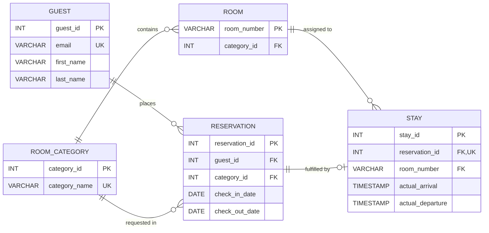

# Hotel Reservation ER Diagram

This entity-relationship diagram models guests, room categories, rooms, reservations, and stays.

## Keys and Notation

- **PK (Primary Key):** Uniquely identifies each row in a table. For example, `guest_id` uniquely identifies each guest.
- **FK (Foreign Key):** Links to the primary key of another table to establish a relationship. For example, `category_id` in `ROOM` references `category_id` in `ROOM_CATEGORY`.
- **UK (Unique Key):** Ensures that values in a column are distinct across the table, such as `email` in `GUEST`.

## Relationships

- **`||--o{` (exactly one to zero or many):** One parent record can link to zero or many child records. For example, a guest can place zero or many reservations, while each reservation belongs to exactly one guest.
- **`||--o|` (exactly one to zero or one):** One parent record can link to at most one child record. A reservation has zero or one stay because it might not have been checked in yet or may be canceled.

## Optional Fields and Additional Rules

- **Optional field:** `actual_departure` in `STAY` is the only optional field; it remains `NULL` until checkout. All other fields across the entities are required.
- **Date checks:** `check_out_date > check_in_date` and `actual_departure >= actual_arrival` require `CHECK` constraints.
- **Overlapping stays:** Preventing overlapping stay dates for a guest or physical room requires database exclusion constraints or triggers.
- **Post-checkout edits:** Preventing edits to `actual_departure` after checkout requires application-level logic or database triggers.
